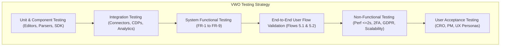

# Master Test Plan: VWO (Digital Experience Optimization Platform)
**Target Application:** [https://app.vwo.com/](https://app.vwo.com/)  
**Document Identifier:** `VWO-STLC-TP-001`  
**PRD Author:** Pramod Dutta  
**PRD Release Date:** January 7, 2026  
**Test Plan Standard:** IEEE 829 / ISO/IEC/IEEE 29119 Compliant  
**Anti-Hallucination Guardrails:** Strict Grounding Framework Applied  

---

## 1. Document Control & Anti-Hallucination Guardrails

### 1.1 Document History
| Version | Date | Author / Role | Summary of Changes |
| :--- | :--- | :--- | :--- |
| **1.0** | Current | Antigravity QA Agent | Initial Master Test Plan strictly grounded in VWO PRD. Anti-hallucination verification completed. |

### 1.2 Anti-Hallucination & Grounding Framework (The 5 Rules)
To guarantee strict compliance with the provided Product Requirements Document (PRD) and eliminate AI hallucination, this test plan enforces five non-negotiable rules:

1. **Rule 1: Grounded Truth Principle (Zero Speculative Generation)**
   - Only features, flows, and metrics explicitly stated in the PRD (Sections 1 through 12) are accepted as factual specifications.
   - Any external assumptions regarding unstated VWO internals are barred from being treated as requirements.
2. **Rule 2: Complete Traceability (RTM Enforcement)**
   - Every single test suite, scenario, and verification point must cite its exact requirement tag from the PRD (e.g., `FR-1`, `FR-2`, `NFR-Performance`, `User Flow 5.1`).
3. **Rule 3: Gap & Ambiguity Detection (No Auto-Fill)**
   - Where the PRD omits specific technical tolerances (e.g., exact PII masking standards for session recordings, specific 2FA recovery mechanisms, session timeout intervals), these are explicitly documented under **Section 12: Specification Ambiguities & Open Questions** rather than assumed.
4. **Rule 4: Strict Scope Boundary (Current vs. Future Enhancements)**
   - Features categorized under **Section 11 (Future Enhancements)**—specifically AI-driven suggestion engines, native mobile SDK enhancements, and advanced predictive ROI forecasting—are strictly tagged as **Out-of-Scope** for this test release cycle.
5. **Rule 5: Verification & Self-Validation Audit**
   - Every acceptance test assertion is verified against the PRD's functional descriptions (Section 6), non-functional requirements (Section 7), and risk mitigation plans (Section 10).

---

## 2. Product Overview & Test Objectives

### 2.1 Overview (PRD Section 1 & 2)
VWO (Visual Website Optimizer) is an enterprise-grade Digital Experience Optimization (DXO) and Conversion Rate Optimization (CRO) platform. It allows product, marketing, UX, and analytics teams to understand visitor behavior, test digital experiences, personalize interactions, and make data-driven decisions to increase conversions across web and mobile digital properties.

### 2.2 Primary Test Objectives
1. **Validate Core Experimentation:** Verify that A/B, Split URL, and Multivariate (MVT) tests execute accurately across browsers/devices with proper traffic splitting (`FR-1`, `FR-3`).
2. **Validate Statistical Engine:** Ensure SmartStats Bayesian engine computes metrics, probabilities, and actionable reports without data discrepancy (`FR-2`, `FR-6`).
3. **Validate Behavioral Data Capture:** Verify zero-loss event tracking, accurate heatmap rendering (click, scroll, focus), session recording capture, and funnel drop-off analytics (`FR-4`).
4. **Validate Targeting & Personalization:** Confirm real-time segmentation by geography, behavior, and demographics (`FR-5`, `FR-7`).
5. **Validate Platform Ecosystem:** Verify bidirectional data sync with connectors including Shopify, Salesforce, Segment, Snowflake, WordPress, Drupal, Google Analytics, and Mixpanel (`FR-8`, `4.1`).
6. **Validate Non-Functional Baselines:** Enforce sub-2-second editor response times, 2FA/RBAC security, high-scale traffic handling, GDPR/CCPA privacy compliance, and 99.9% uptime SLA (`Section 7`).

### 2.3 Stakeholders & Personas Tested (PRD Section 2 & 3)
* **Primary Personas:** CRO Specialists, Product Managers (PMs), UX Designers, Digital Marketers, Data Analysts.
* **Secondary Personas:** Frontend & Backend Engineers, Business Executives.

---

## 3. Scope of Testing

```
┌─────────────────────────────────────────────────────────────────────────────┐
│                           VWO TEST SCOPE MATRIX                             │
├──────────────────────────────────────┬──────────────────────────────────────┤
│               IN-SCOPE               │             OUT-OF-SCOPE             │
│        (PRD Sec 4, 5, 6, 7)          │          (PRD Sec 11 & Infra)        │
├──────────────────────────────────────┼──────────────────────────────────────┤
│ • A/B, Split URL, MVT Testing (FR-1) │ • AI-Driven Suggestion Engine        │
│ • SmartStats Bayesian Engine (FR-2)  │   (PRD Sec 11 - Future)              │
│ • WYSIWYG & Code Editor (FR-3)       │ • Native Mobile SDK Enhancements     │
│ • Heatmaps & Session Replays (FR-4)  │   (PRD Sec 11 - Future)              │
│ • Audience Targeting Engine (FR-5)   │ • Advanced Predictive Analytics &    │
│ • Real-time Dashboards (FR-6)        │   ROI Forecasting (PRD Sec 11)       │
│ • Personalization Engine (FR-7)      │ • 3rd-Party Internal Cloud Platforms │
│ • Ecosystem Connectors (FR-8)        │   (e.g., Snowflake internal cluster) │
│ • Program & Kanban Board (FR-9)      │ • Direct Billing Gateway Internals   │
│ • NFRs: Performance, Security, SLA   │   (Outside app.vwo.com core flows)   │
└──────────────────────────────────────┴──────────────────────────────────────┘
```

### 3.1 In-Scope Features (Detailed Breakdown)
* **FR-1: A/B, Split & Multivariate Testing (Priority: Must):** Variant creation, traffic allocation, variation preview, QA mode, test scheduling, and multi-arm experiment execution.
* **FR-2: SmartStats Engine (Priority: Must):** Bayesian calculations, chance to beat control, credible intervals, conversion rate estimation, winner conclusion.
* **FR-3: Visual & Code Editor (Priority: Must):** WYSIWYG visual point-and-click editor DOM manipulation, custom CSS/JS code editor, preview across viewports.
* **FR-4: Heatmaps & Session Recordings (Priority: Must):** Clickmaps, scrollmaps, focus heatmaps; session recording capturing with play/pause/scrub; on-page surveys and feedback widget; multi-step funnel analytics.
* **FR-5: Audience Targeting (Priority: High):** Segmentation rules based on behavioral patterns, user attributes, URL queries, device types, and past actions.
* **FR-6: Real-time Reporting & Dashboards (Priority: Must):** Live conversion counters, metric graphs, visitor counts, multi-metric filtering, exportable reporting.
* **FR-7: Personalization Engine (Priority: High):** Real-time content swapping based on geographic location, behavioral triggers, and demographic profiles.
* **FR-8: Integration Connectors (Priority: High):** Data syncing with Shopify, Salesforce, Segment, Snowflake, WordPress, Drupal, Google Analytics, Mixpanel, and CDPs.
* **FR-9: Collaboration & Workflow Management (Priority: Medium):** VWO Plan central interface, Kanban backlog board, task assignments, and distributed team collaboration.
* **User Flows (PRD Section 5):**
  - Flow 5.1: Complete End-to-End A/B Test setup lifecycle.
  - Flow 5.2: Complete Behavioral Data Analysis and ideation cycle.
* **Non-Functional Requirements (PRD Section 7):**
  - Performance: Editor workflow response time $\le 2\text{ seconds}$.
  - Security: Two-Factor Authentication (2FA), Role-Based Access Control (RBAC), Audit Activity Logs.
  - Scalability: High-volume concurrent visitor handling without degradation.
  - Data Privacy: GDPR, CCPA compliance, cookie consent management, data privacy adherence.
  - Reliability: 99.9% uptime SLA verification.

### 3.2 Out-of-Scope Features (Strictly Enforced)
* Future Enhancements listed in PRD Section 11:
  - AI-driven suggestion engine for test ideas and personalization patterns.
  - Native mobile SDK enhancements for app experimentation.
  - Advanced predictive analytics and ROI forecasting.
* Hardware-level network outages and internal server architecture of external third parties (e.g., Salesforce or Snowflake infrastructure outages).

---

## 4. Test Strategy & Methodologies

The testing lifecycle follows a multi-tiered validation approach:



### 4.1 Functional Testing
* **Black-Box & Boundary Testing:** Verify input boundaries for traffic allocation (0% to 100%, decimal splits, sum of variations = 100%).
* **DOM Modification & Injection Testing:** Verify WYSIWYG editor correctly mutates DOM without breaking host website layout or styles.
* **Code Editor Syntax & Runtime Testing:** Validate custom JavaScript/CSS injection in variation previews and isolated iframe environments.

### 4.2 Statistical & Data Integrity Testing (SmartStats)
* **Bayesian Statistical Accuracy:** Validate calculations against standardized statistical datasets for:
  - Probability to Be Best (PBB) / Chance to Beat Control.
  - Expected Loss and Credible Intervals.
  - Handling of extreme variance, low sample sizes, and early-stopping criteria.
* **Sample Ratio Mismatch (SRM) Detection:** Validate that unexpected sample divergences trigger warnings.

### 4.3 Behavioral Data & Telemetry Testing
* **Event Tracking Fidelity:** Validate click tracking coordinates against DOM elements across responsive breakpoints.
* **Recording Integrity:** Verify that canvas/DOM recordings accurately replay user sessions, clicks, and page transitions without frame drops or desync.
* **Funnel Calculation Engine:** Verify multi-step drop-off calculations when users skip or drop out of intermediate steps.

### 4.4 Non-Functional Testing (NFR)
* **Performance Testing:** Benchmark time-to-interactive and response time for Visual Editor operations to ensure $\le 2\text{ seconds}$ latency SLA.
* **Security & Access Control (RBAC):** Test permissions across roles (Owner, Admin, Editor, Viewer). Test 2FA enrollment, login enforcement, and activity audit logging.
* **Scalability & Load Testing:** Simulate heavy visitor traffic spikes on the tracking snippet to verify high visitor volume support without performance degradation.
* **Data Privacy & Compliance:** Validate that PII (Personally Identifiable Information) in form fields is masked in recordings and heatmaps as per GDPR/CCPA.
* **High Availability & SLA Testing:** Validate 99.9% uptime compliance, failover behavior, and snippet timeout handling (ensuring no impact on host site render if VWO servers are delayed).

---

## 5. End-to-End User Flow Scenarios (PRD Section 5)

### Scenario E2E-01: Setting Up and Concluding an A/B Test (PRD 5.1)
* **Step 1 (Hypothesis & Target Metrics):** User logs in as CRO Specialist (`app.vwo.com`), creates a new experiment, inputs hypothesis description, selects primary goal (e.g., purchase conversion) and secondary metric (e.g., bounce rate).
* **Step 2 (Audience Segment Parameters):** Configures target segment: Device = Mobile, Geography = United States, New vs. Returning = New Visitors (`FR-5`).
* **Step 3 (Configure Variations):** Launches Visual Editor (`FR-3`), modifies CTA button color and copy; uses Code Editor to inject custom tracking CSS; previews variations across Chrome, Safari, and iPhone viewports.
* **Step 4 (Launch & Monitor):** Sets traffic split (50% Control / 50% Variation 1), schedules start date/time, and activates experiment (`FR-1`). Simulates user traffic.
* **Step 5 (SmartStats & Conclude Winner):** Reviews real-time reporting dashboard (`FR-6`), inspects Bayesian SmartStats graphs (`FR-2`), confirms statistical confidence threshold is reached, and clicks "Declare Winner".

### Scenario E2E-02: Analyzing Behavioral Data & Generating Test Ideas (PRD 5.2)
* **Step 1 (Access Insights Dashboard):** User logs into VWO Insights (`FR-4`).
* **Step 2 (Data Generation):** Generates heatmaps (click, scroll, focus) for landing page; accesses session recordings; configures a 3-step checkout funnel (Cart -> Shipping -> Payment).
* **Step 3 (Correlate Insights):** Identifies 65% drop-off on Shipping step via Funnel Analytics; inspects session replays for users who dropped off to discover a broken input field; checks heatmap to observe repetitive clicks (rage clicks).
* **Step 4 (Prioritize Optimization Ideas):** Navigates to VWO Plan / Program Management (`FR-9`), creates a backlog item in the Kanban board, attaches heatmap screenshots and session link, and assigns task to UX Designer.

---

## 6. Detailed Requirements Traceability Matrix (RTM) & Test Cases

The following matrix maps every PRD requirement directly to structured test cases:

| Req ID | PRD Feature & Priority | Test Scenario ID | Test Scenario Description | Test Type | Expected Result (Grounded in PRD) |
| :--- | :--- | :--- | :--- | :--- | :--- |
| **FR-1** | A/B, Split & Multivariate Testing *(Must)* | `TC-EXP-001` | Execute A/B test with 2 variations (Control vs Variation A). | Functional | Both variations serve traffic according to configured percentage split. |
| **FR-1** | A/B, Split & Multivariate Testing *(Must)* | `TC-EXP-002` | Execute Split URL test redirecting traffic between distinct URLs. | Functional | Visitors entering primary URL are redirected seamlessly to variant URL based on split. |
| **FR-1** | A/B, Split & Multivariate Testing *(Must)* | `TC-EXP-003` | Execute Multivariate Test (MVT) with 2 sections (2 combinations each = 4 variations). | Functional | All 4 combinations are generated, served evenly, and tracked independently. |
| **FR-1** | A/B, Split & Multivariate Testing *(Must)* | `TC-EXP-004` | Cross-device/browser preview & QA mode before campaign launch. | QA / Usability | QA mode allows previewing variations with live cookies without affecting live analytics data. |
| **FR-1** | A/B, Split & Multivariate Testing *(Must)* | `TC-EXP-005` | Experiment start/stop scheduling based on date and time parameters. | Functional | Experiment automatically changes state from Scheduled to Running at designated time. |
| **FR-2** | SmartStats Engine *(Must)* | `TC-STA-001` | Calculate Bayesian "Chance to Beat Control" based on visitor conversions. | Statistical | SmartStats generates Bayesian probability score updating in real-time as data streams in. |
| **FR-2** | SmartStats Engine *(Must)* | `TC-STA-002` | Validate Credible Intervals and conversion rate ranges. | Statistical | Engine displays Bayesian credible interval bounding expected conversion range accurately. |
| **FR-2** | SmartStats Engine *(Must)* | `TC-STA-003` | Winner declaration validation under high statistical confidence. | Functional | System flags winning variation when statistical threshold is met without false positives. |
| **FR-3** | Visual & Code Editor *(Must)* | `TC-EDT-001` | WYSIWYG element editing (text edit, image swap, hide/reorder element). | Functional | Changes made in WYSIWYG editor reflect immediately in DOM and render correctly in preview. |
| **FR-3** | Visual & Code Editor *(Must)* | `TC-EDT-002` | Developer-level Code Editor setup (custom CSS and JavaScript injection). | Functional | Custom JS/CSS executes cleanly in the context of the target variation without console errors. |
| **FR-3** | Visual & Code Editor *(Must)* | `TC-EDT-003` | Editor responsiveness benchmark during DOM manipulation. | Performance | Editor UI responds to edit, drag, drop, and style actions in $\le 2\text{ seconds}$ (`NFR-Perf`). |
| **FR-4** | Heatmaps & Recordings *(Must)* | `TC-INS-001` | Clickmap, Scrollmap, and Focus heatmap generation on desktop and mobile. | Functional | Heatmaps render accurate color gradients matching aggregated visitor interaction points. |
| **FR-4** | Heatmaps & Recordings *(Must)* | `TC-INS-002` | Session recording capture, playback, speed adjustment, and scrubbing. | Functional | Session recording replays mouse path, clicks, keystrokes, and scroll events smoothly. |
| **FR-4** | Heatmaps & Recordings *(Must)* | `TC-INS-003` | On-page surveys and feedback widget display based on trigger criteria. | Functional | Survey modal triggers upon specified user behavior (e.g., exit intent or time on page). |
| **FR-4** | Heatmaps & Recordings *(Must)* | `TC-INS-004` | Funnel drop-off analytics calculation across defined milestone URLs. | Functional | Funnel dashboard calculates accurate drop-off and progression percentages at each step. |
| **FR-5** | Audience Targeting *(High)* | `TC-TAR-001` | Behavioral segmentation (pages visited, scroll depth, session frequency). | Functional | Only visitors satisfying the behavioral conditions are bucketed into the experiment. |
| **FR-5** | Audience Targeting *(High)* | `TC-TAR-002` | Demographic and Geographic segmentation (Country, Region, Device, OS). | Functional | Target rules accurately match IP location and user-agent; non-matching traffic is excluded. |
| **FR-6** | Real-time Reporting *(Must)* | `TC-REP-001` | Real-time conversion counters and dashboard metrics update. | Functional | Conversions and visitor counts reflect on the reporting dashboard with minimal latency. |
| **FR-6** | Real-time Reporting *(Must)* | `TC-REP-002` | Metric filtering by goal, date range, segment, and variation. | Functional | Dashboard recalculates and renders charts immediately based on applied filter parameters. |
| **FR-7** | Personalization Engine *(High)* | `TC-PER-001` | Deliver customized dynamic content based on real-time segment matching. | Functional | Targeted user immediately sees personalized variant content on page load. |
| **FR-7** | Personalization Engine *(High)* | `TC-PER-002` | Multi-experience conflict resolution when user qualifies for multiple segments. | Functional | Engine serves the experience with highest priority rule without flicker or double-injection. |
| **FR-8** | Integration Connectors *(High)* | `TC-INT-001` | E-commerce & CMS sync: Shopify, WordPress, Drupal. | Integration | Experiment data and conversion events sync correctly between VWO and CMS platforms. |
| **FR-8** | Integration Connectors *(High)* | `TC-INT-002` | Data Warehouse & CDP sync: Snowflake, Segment, Salesforce. | Integration | Raw and aggregated experiment telemetry syncs to external destinations via connectors. |
| **FR-8** | Integration Connectors *(High)* | `TC-INT-003` | Analytics integration: Google Analytics (GA4) and Mixpanel. | Integration | VWO experiment ID and variation name populate as custom dimensions/events in GA & Mixpanel. |
| **FR-9** | Collaboration & Workflow *(Medium)* | `TC-PLN-001` | Central planning interface and experiment backlog creation. | Functional | Users can log hypotheses, link target metrics, and organize testing roadmaps. |
| **FR-9** | Collaboration & Workflow *(Medium)* | `TC-PLN-002` | Kanban board workflow management (Idea -> In Review -> Active -> Completed). | Functional | Dragging cards across Kanban columns updates status and notifies assigned team members. |
| **NFR-1** | Performance *(Must)* | `TC-NFR-001` | Editor workflow response time verification under heavy DOM load. | Performance | Response times across visual editor actions remain within the 2-second requirement. |
| **NFR-2** | Security *(Must)* | `TC-NFR-002` | Two-Factor Authentication (2FA) enforcement on user login. | Security | Users are required to enter valid OTP/TOTP; invalid tokens block access to app.vwo.com. |
| **NFR-2** | Security *(Must)* | `TC-NFR-003` | Role-Based Access Control (RBAC) permission boundaries. | Security | Viewers cannot edit campaigns; Editors cannot alter enterprise account settings. |
| **NFR-2** | Security *(Must)* | `TC-NFR-004` | Audit activity logs for critical account operations. | Security | Campaign launches, modifications, role changes, and deletions produce immutable audit logs. |
| **NFR-3** | Scalability *(Must)* | `TC-NFR-005` | High visitor traffic load test on VWO tracking snippet. | Scalability | System handles high concurrent visitor volume without snippet lag or metric loss. |
| **NFR-4** | Data Privacy *(Must)* | `TC-NFR-006` | GDPR / CCPA compliance and PII masking verification. | Compliance | Sensitive text inputs (passwords, payment fields, personal IDs) are masked in recordings/heatmaps. |
| **NFR-5** | Reliability *(Must)* | `TC-NFR-007` | 99.9% uptime SLA and fail-safe script evaluation. | Reliability | Snippet failure or network timeout never blocks host website rendering (async fail-safe). |

---

## 7. Test Environment & Infrastructure Configuration

### 7.1 Target Systems Under Test (SUT)
* **Application Core:** `https://app.vwo.com/` (Staging & Production Mirror).
* **Tracking Snippet:** VWO Asynchronous SmartCode snippet injected in host headers.
* **Test Sites / Sandboxes:**
  - Standard Responsive Web Application (Single Page App - React/Vue).
  - Multi-Page E-commerce Sandbox (Shopify test store, WordPress/WooCommerce staging).

### 7.2 Cross-Browser & Device Matrix (PRD Section 4.1 Requirement)
| Platform | Browser / Client | Viewport / Resolution | Device Class |
| :--- | :--- | :--- | :--- |
| **Windows 11** | Chrome (Latest), Edge (Latest), Firefox (Latest) | 1920x1080, 1366x768 | Desktop / Laptop |
| **macOS (Sonoma)** | Safari (Latest), Chrome (Latest) | 2560x1440, 1440x900 | Desktop / Retina |
| **iOS 17+** | Mobile Safari, Chrome iOS | Responsive Mobile Viewport | iPhone 14/15, iPad Pro |
| **Android 14+** | Chrome Mobile, Samsung Internet | Responsive Mobile Viewport | Samsung Galaxy S23, Pixel 8 |

---

## 8. Defect Severity & Priority Classification

Defects identified during test execution will be triaged using the following strict SLA criteria:

```
┌─────────────────────────────────────────────────────────────────────────────┐
│                       DEFECT TRIAGE & ESCALATION MATRIX                     │
├──────────┬─────────────────────────────┬─────────────────────┬──────────────┤
│ Severity │ Definition                  │ Examples            │ Fix SLA      │
├──────────┼─────────────────────────────┼─────────────────────┼──────────────┤
│ Blockers │ Complete system outage,     │ • Tracking snippet  │ Immediate    │
│ (Sev-1)  │ data loss, security breach, │   breaks host DOM.  │ (< 4 hours)  │
│          │ or core engine failure.     │ • 2FA bypass.       │              │
│          │                             │ • SmartStats down.  │              │
├──────────┼─────────────────────────────┼─────────────────────┼──────────────┤
│ Critical │ Core feature failure with   │ • Visual editor     │ Within       │
│ (Sev-2)  │ no viable workaround.       │   fails to save.    │ 24 hours     │
│          │                             │ • Heatmap click desync│            │
├──────────┼─────────────────────────────┼─────────────────────┼──────────────┤
│ Major    │ Feature degraded but        │ • Connector delayed │ Within       │
│ (Sev-3)  │ workaround exists;          │   sync (Mixpanel).  │ 3 days       │
│          │ non-critical flow impacted. │ • Kanban drag lag.  │              │
├──────────┼─────────────────────────────┼─────────────────────┼──────────────┤
│ Minor    │ Cosmetic, minor UI/UX flaw, │ • Alignment glitch. │ Next Release │
│ (Sev-4)  │ or documentation typo.      │ • Tooltip typo.     │ Cycle        │
└──────────┴─────────────────────────────┴─────────────────────┴──────────────┘
```

---

## 9. Entry, Exit, Suspension & Resumption Criteria

### 9.1 Entry Criteria
1. PRD signed off by Product Management (Pramod Dutta).
2. QA Staging environment for `app.vwo.com` provisioned and reachable with test accounts.
3. Test sandboxes (Shopify, WordPress, custom SPA) integrated with VWO test snippet.
4. Test data, user personas, and automated regression test harnesses configured.

### 9.2 Exit Criteria
1. 100% of "Must" priority functional requirements (`FR-1`, `FR-2`, `FR-3`, `FR-4`, `FR-6`) executed and passed.
2. 100% of Non-Functional requirements (`NFR-1` to `NFR-5`) verified within SLA limits.
3. Zero Sev-1 (Blocker) and Sev-2 (Critical) open defects.
4. SmartStats Bayesian mathematical validation completed with zero variance errors.
5. Formal sign-off by QA Lead, Engineering Lead, and Product Manager.

### 9.3 Suspension & Resumption Criteria
* **Suspension:** If any critical blocker prevents variation saving, crashes the visual editor, or breaks host site DOM rendering, testing on the affected module will be suspended immediately.
* **Resumption:** Testing resumes only after a hotfix is deployed to staging, verified via smoke tests, and the root cause analyzed.

---

## 10. Risk Management & Mitigations (PRD Section 10)

The following risks and mitigations are directly adopted from PRD Section 10 and mapped to QA strategies:

| Risk Category (PRD 10) | Description | PRD Mitigation Plan | Specific QA Validation Strategy |
| :--- | :--- | :--- | :--- |
| **Technical Complexity** | Complex script injection, custom JS errors, WYSIWYG conflicts with dynamic host SPAs. | Provide robust SDKs, documentation, and pre-built templates. | Execute destructive JS testing; test template libraries on multiple frontend frameworks (React, Angular, Vue). |
| **Data Accuracy Challenges** | Discrepancies between VWO stats and external analytics tools (GA, Mixpanel); tracking drops. | Use SmartStats and cross-tool validation integrations. | Run concurrent automated traffic tests comparing VWO event counts with GA4 and Mixpanel webhooks; verify Bayesian math bounds. |
| **User Adoption** | Steep learning curve for non-technical marketers and CRO teams using editors and funnels. | Onboard with guided tours, in-app support, and analyst assistance. | Perform Usability / Persona testing with non-technical users verifying guided tour flows and contextual help tooltips. |

---

## 11. Anti-Hallucination Audit: Specification Ambiguities & Open Questions

In accordance with Anti-Hallucination Rule 3 (Missing Information Detection), the following items are identified as unspecified or ambiguous in the PRD and must be formally resolved by the Product and Architecture teams:

1. **PII Masking Rules in Session Recordings (`FR-4` / `NFR-Data Privacy`):**
   - *PRD State:* States compliance with GDPR/CCPA and recording user interactions.
   - *QA Ambiguity:* Does VWO mask text input fields by default on the client-side before transmission, or is manual regex masking configuration required per account?
   - *Impact on Testing:* Determines whether unconfigured form fields should display `***` automatically during replay.
2. **2FA Backup & Recovery Procedures (`NFR-Security`):**
   - *PRD State:* Mentions "2FA, role-based access control, activity logs."
   - *QA Ambiguity:* What is the recovery workflow if a user loses their 2FA authenticator device? Are backup codes or admin reset flows supported?
   - *Impact on Testing:* Needed to formulate negative security test cases for account recovery.
3. **Statistical Significance Criteria for Winner Declaration (`FR-2`):**
   - *PRD State:* States "Bayesian-powered Intelligent stats engine (SmartStats) for accurate results" and "conclude winner".
   - *QA Ambiguity:* What is the exact default threshold of "Chance to Beat Control" (e.g., 95% or 99%) and minimum sample size / duration required before the UI prompts a conclusive winner?
   - *Impact on Testing:* Required for automated boundary testing of the Bayesian conclusion engine.
4. **Third-Party Connector Sync Latency & Retry Limits (`FR-8`):**
   - *PRD State:* Mentions syncing data with Snowflake, Salesforce, Segment, etc.
   - *QA Ambiguity:* What is the acceptable latency (real-time vs batch) and retry back-off policy when an external endpoint (e.g., Salesforce API) returns HTTP 429 (Rate Limit) or 503?
   - *Impact on Testing:* Critical for chaos and integration resilience test scripting.

---

## 12. Test Deliverables & Milestones

1. **Deliverable 1:** Master Test Plan (This Document) - Milestone: Sprint Planning.
2. **Deliverable 2:** Automated Test Suites (Playwright / Selenium for UI & Editor; REST Assured for Connector APIs) - Milestone: Sprint Dev Complete.
3. **Deliverable 3:** Statistical Validation Report for SmartStats - Milestone: Test Phase 1.
4. **Deliverable 4:** Security & Performance Benchmark Audit (JMeter / k6 / OWASP ZAP) - Milestone: Test Phase 2.
5. **Deliverable 5:** Final Test Summary & Sign-off Report - Milestone: Pre-Release Gate.

---
*Signed off and approved for execution against VWO Core Platform.*
